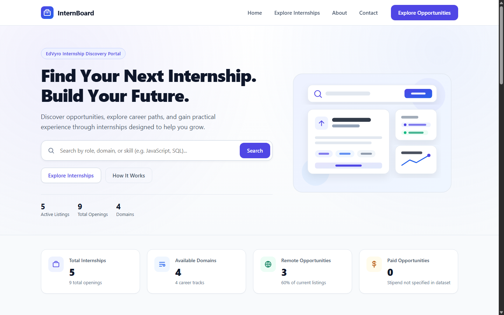
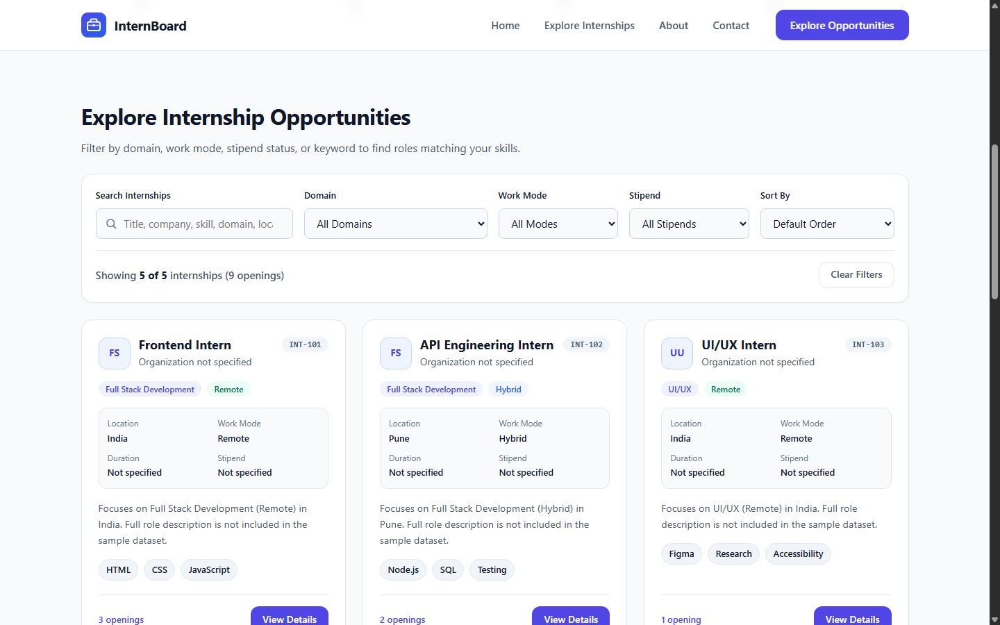
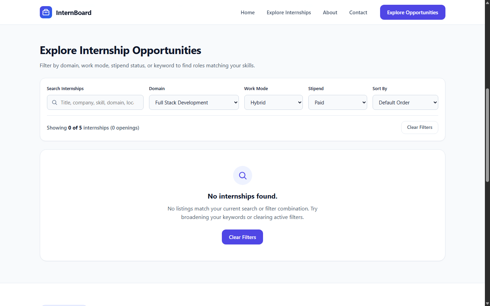
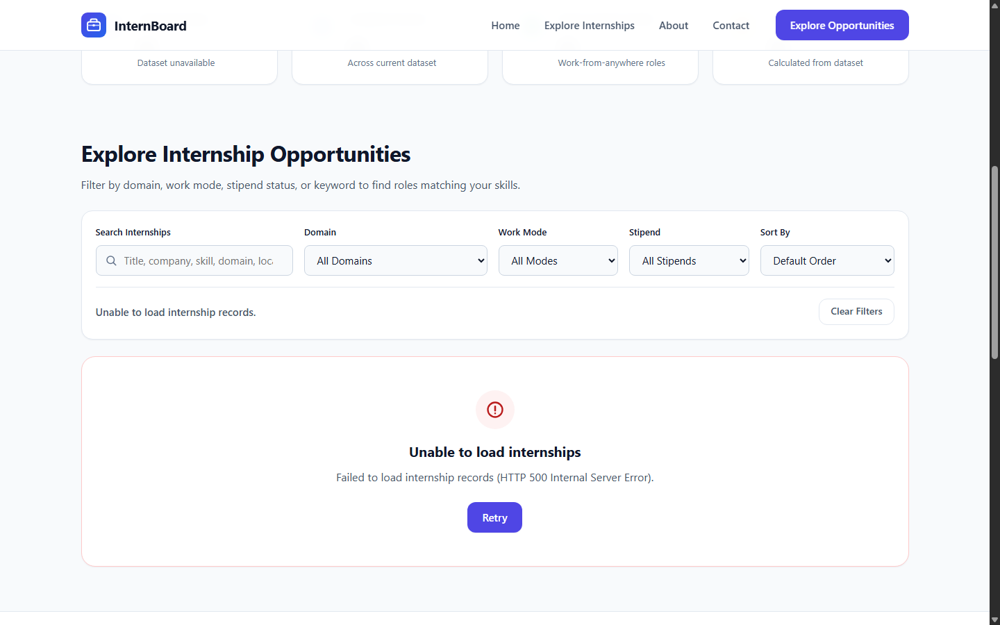
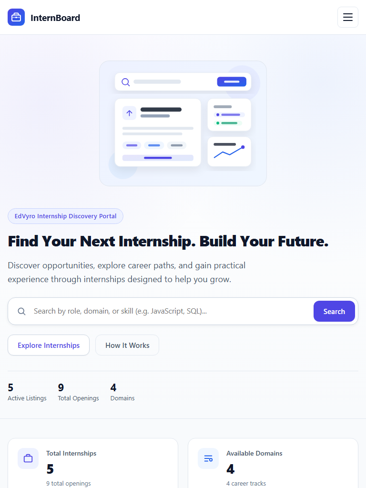

# InternBoard — Responsive Internship Board & Secure REST API

> **EdVyro Full Stack Development Internship — Tasks 2, 3 & 4 (Secure Application Integration)**  
> A production-structured full-stack application featuring a responsive, accessible frontend built entirely with semantic **HTML5**, modern **CSS3**, and modular **Vanilla JavaScript (ES6+)**, integrated securely with a **Node.js / Express REST API** and persistent **SQLite database** protected by rate limiting, security headers, parameterized queries, and dual-layer validation.

---

## 1. Project Overview

**InternBoard** is a complete, production-quality full-stack platform where students can explore verified internship opportunities, filter and search listings, view in-depth role details in an accessible modal dialog, and submit internship applications with real-time client-side feedback and server-side validation.

The project demonstrates progressive, clean full-stack architecture:
- **Task 2**: Responsive, zero-framework Vanilla JS frontend with accessible UI, search, multi-domain filtering, statistics, and modal dialogues.
- **Task 3**: Production-structured Node.js/Express REST API backed by persistent SQLite storage, pagination, and parameterized CRUD endpoints.
- **Task 4**: Secure client-server application integration, interactive application submission modal, dual-layer validation, rate limiting (`express-rate-limit`), security headers (`helmet`), and duplicate application prevention.

---

## 2. Problem Statement

Students seeking early-career internships often encounter cluttered job boards that mix unverified postings, lack clear skill requirements, fail on mobile viewports, or lack accessible navigation. Additionally, job application endpoints are frequently vulnerable to automated spam, SQL injection, and data leakage. InternBoard solves this through a clean, accessible interface backed by an enterprise-hardened, parameterized API.

---

## 3. Features

### Frontend (Tasks 2 & 4)
- **Dynamic API & Dataset Integration**: Fetches records from the Express API (`GET /api/internships`) with automatic fallback to `data/internships.json` when the backend is offline.
- **Live Statistics Dashboard**: Real-time totals for Total Internships, Openings, Domains, Remote Roles, and Stipend distributions.
- **Multi-Filter & Case-Insensitive Search**: Search by title, domain, skills, or location, and compose domain, work mode, and stipend filters simultaneously.
- **Accessible Role Details Modal**: Fully accessible dialog (`role="dialog"`, `aria-modal="true"`) with keyboard trap, `Escape` key close, and focus restoration.
- **Interactive Application Modal (Task 4)**: Submit applications directly from internship cards or details modal with inline client validation, loading state spinner, duplicate rejection handling, and confirmation receipt.
- **Accessible Form Controls**: Semantic labels, live validation error feedback (`aria-describedby`, `aria-invalid`), keyboard navigation, and focus restoration.
- **Empty & Error States**: Contextual empty states (`"No internships found."`) and recoverable error UI with retry capabilities.
- **Responsive Navigation**: Mobile hamburger drawer with keyboard controls, supporting viewports from 360px to 1920px.

### Backend & Security (Tasks 3 & 4)
- **Node.js & Express REST API**: Predictable envelope architecture for all responses (`status`, `data`, `message`, `errors`).
- **Persistent SQLite Storage**: Embedded SQLite database (`better-sqlite3`) with foreign key enforcement and indexes.
- **Application Submission (`POST /api/applications`)**: Server-validated application submission with unique candidate constraints per internship.
- **Rate Limiting (`express-rate-limit`)**: Anti-spam protection on application submissions (10 requests per 15-minute window per IP) while keeping listing browsing completely unthrottled.
- **Security Headers (`helmet`)**: Industry-standard HTTP headers (`nosniff`, `SAMEORIGIN`, `cross-origin` resource policy).
- **Parameterized SQL**: 100% of queries use positional prepared statement parameters (`?`), eliminating SQL injection.
- **Data Privacy**: Applicant personal details are never exposed in public listing endpoints or server logs.

---

## 4. Technology Stack

- **Frontend**: HTML5, CSS3 (Custom properties, CSS Grid, Flexbox), Vanilla JavaScript (ES6+ native modules)
- **Backend**: Node.js (v18.0.0+), Express.js (v4.21+)
- **Database**: SQLite 3 with `better-sqlite3` driver
- **Security Middleware**: `helmet` (v8.1.0), `express-rate-limit` (v7.5.0), `cors` (v2.8.5)
- **Testing**: Built-in Node.js test runner (`node:test`, `node:assert/strict`) with `supertest`
- **Deployment**: GitHub Pages (Frontend static hosting) & Local Node.js Express server

*(Strictly zero frontend frameworks: No React, Vue, Angular, Next.js, Bootstrap, or Tailwind CSS).*

---

## 5. Project Folder Structure

```text
.
├── index.html                           # Main frontend application entry point
├── css/
│   ├── style.css                        # Design system, layout, cards, modals, forms
│   └── responsive.css                   # Responsive breakpoints (360px to 1920px)
├── js/
│   ├── app.js                           # Frontend controller and initialization
│   ├── config.js                        # API URL discovery & configuration (Task 4)
│   ├── data.js                          # API & JSON data loader with error recovery (Task 4)
│   ├── application.js                   # Application form validation & submission (Task 4)
│   ├── filters.js                       # Composable search, filter, and sorting engine
│   ├── ui.js                            # DOM rendering, modals, and statistics
│   └── validation.js                    # Schema validation and data normalization
├── data/
│   └── internships.json                 # Official 5 EdVyro sample records (fallback dataset)
├── backend/                             # Complete Node.js / Express REST API (Tasks 3 & 4)
│   ├── package.json                     # Backend dependencies and test scripts
│   ├── .env.example                     # Environment template (PORT, RATE_LIMIT)
│   ├── database/
│   │   ├── schema.sql                   # SQLite schema (internships + applications)
│   │   ├── seed.js                      # Idempotent database seeder (INT-101 to INT-105)
│   │   └── init.js                      # Database initialization script
│   ├── src/
│   │   ├── app.js                       # Express app configuration & middleware
│   │   ├── server.js                    # Server HTTP listener entry point
│   │   ├── config/database.js           # SQLite connection management & PRAGMAs
│   │   ├── middleware/
│   │   │   ├── errorHandler.js          # Centralized error handler
│   │   │   └── rateLimiter.js           # express-rate-limit configuration (Task 4)
│   │   ├── validators/
│   │   │   ├── internshipValidator.js   # Internship payload schema validation
│   │   │   └── applicationValidator.js  # Application payload schema validation (Task 4)
│   │   ├── services/
│   │   │   ├── internshipService.js     # Internship business logic & SQL operations
│   │   │   └── applicationService.js    # Application submission & duplicate checks (Task 4)
│   │   ├── controllers/
│   │   │   ├── internshipController.js  # Internship route controllers
│   │   │   └── applicationController.js # Application submission controller (Task 4)
│   │   └── routes/
│   │       ├── internshipRoutes.js      # /api/internships router
│   │       └── applicationRoutes.js     # /api/applications router (Task 4)
│   ├── tests/
│   │   ├── internships.test.js          # 26 automated tests for Task 3 REST API
│   │   └── applications.test.js         # 18 automated tests for Task 4 Security & Apps
│   └── README.md                        # Comprehensive backend API documentation
├── tests/
│   └── frontend.test.mjs                # 13 automated frontend & environment tests
├── assets/
│   └── images/                          # Brand logos and SVG illustrations
├── screenshots/                         # Multi-breakpoint UI verification captures
├── .gitignore
└── README.md
```

*(Note: Entry files are placed at the repository root so GitHub Pages and Netlify can deploy directly from the `main` branch root without extra path configuration.)*

---

## 6. Installation Instructions

1. Clone the repository:
   ```bash
   git clone https://github.com/nijjukrr/EDVYRO--RESPONSIVE-Internship-.git
   cd EDVYRO--RESPONSIVE-Internship-
   ```
2. No `npm install` or build step is required because the project uses pure HTML, CSS, and native ES6 modules.

---

## 7. How to Run Locally

Because the application loads `data/internships.json` via `fetch()` and uses `<script type="module">`, run it through a local static HTTP server rather than opening `index.html` over `file://`:

- **Option A — VS Code Live Server**: Right-click `index.html` and select **Open with Live Server**.
- **Option B — Python**:
  ```bash
  python -m http.server 8080
  ```
  Then open `http://localhost:8080` in your browser.
- **Option C — Node.js**:
  ```bash
  npx serve .
  ```

---

## 8. How Search and Filters Work

1. **Validation (`js/validation.js`)**: `validateDataset()` and `validateInternship()` check required fields (`id`, `title`, `domain`, `mode`, `location`, `skills`), normalize whitespace, sanitize any optional `http:`/`https:` `applicationUrl`, and leave omitted optional fields as `null` instead of fabricating values.
2. **Search (`searchInternships`)**: Trims leading/trailing whitespace, converts the query to lowercase, and checks `id`, `title`, `company`, `description`, `domain`, `location`, `mode`, and every entry in `skills`.
3. **Composable Filters (`applyAllFilters`)**: Chains `searchInternships()` → `filterByDomain()` → `filterByWorkMode()` → `filterByStipend()` → `sortInternships()` on immutable copies of the dataset so every filter updates simultaneously with the search bar and live results counter.

---

## 9. Accessibility Features

- **Skip Link**: `"Skip to main content"` link visible on keyboard focus.
- **Semantic Landmarks & Headings**: Single `<h1>` in the hero followed by ordered `<h2>` and `<h3>` headings.
- **Explicit Form Labels**: Every `<input>` and `<select>` element has a matching `<label for="...">`.
- **Keyboard Navigation & Focus Management**:
  - Visible `:focus-visible` outlines across links, buttons, inputs, and selects.
  - Modal traps `Tab` and `Shift+Tab` inside the dialog, closes on `Escape`, and returns focus to the triggering **View Details** button.
  - Mobile hamburger menu updates `aria-expanded` and closes on `Escape`.
- **Live Announcements**: `#results-count` uses `aria-live="polite"` to announce updated match counts.
- **Reduced Motion**: Honors `@media (prefers-reduced-motion: reduce)`.

---

## 10. Responsive Design Details

Tested across mobile, tablet, and desktop viewports with zero horizontal overflow (`scrollWidth <= innerWidth`):

- **Mobile (`360px`, `375px`, `390px`, `430px`)**: Single-column card layout, collapsible hamburger navigation drawer, stacked hero search bar and card action footer, touch-friendly `>= 44px` controls.
- **Tablet (`768px`, `1024px`)**: Two-column statistics and listing grid, multi-row filter controls.
- **Desktop (`1280px`, `1440px`, `1920px`)**: Three-column internship card grid, four-column statistics bar, and single-row five-control search/filter panel inside a `1240px` max-width container.

---

## 11. Testing & Verification Results

All tests have been executed and verified using Node.js test suites and headless Chrome DevTools Protocol (CDP) automation across both the local server and the live GitHub Pages deployment.

### Functional Verification
- **Dataset Loading**: 5/5 valid records loaded from `data/internships.json` (`INT-101` through `INT-105`) with 0 schema validation errors.
- **Dynamic Statistics**: Calculated dynamically from dataset: 5 active listings, 9 total openings, 4 unique domains, 3 remote opportunities, 0 paid (accurately reflects dataset where stipend values are not specified).
- **Search Verification**: Case-insensitive and trimmed search tested (`"  JAVASCRIPT "` returns `INT-101`, `"sql"` returns `INT-102` & `INT-104`, nonexistent terms display empty state). Hero search input and listing search input are fully synchronized.
- **Domain & Mode Filtering**: Multiple simultaneous filter conditions tested (`Full Stack Development` + `Hybrid` returns `API Engineering Intern` `INT-102`).
- **Sorting**: Verified `Title (A–Z)`, `Title (Z–A)`, `Openings (High to Low)`, and `Openings (Low to High)`.
- **Clear Filters**: Restores full 5-card list, clears search inputs, and resets all dropdowns.
- **Empty State**: Displays `"No internships found."` with active **Clear Filters** and **Reset Search** buttons.
- **Error & Recovery State**: Simulated HTTP 500 error triggers error card with diagnostic message; clicking **Retry** successfully re-fetches and renders all listings.
- **Modal & Accessibility**:
  - Details modal displays all metadata, responsibilities, required skills, and clear application status without fabricating missing URLs.
  - Initial focus moves to the top close button (`#modal-close-top`).
  - Focus is trapped within modal interactive elements.
  - Pressing `Escape` closes the modal and restores keyboard focus to the triggering **View Details** button.
- **Form Accessibility**: 100% of `<input>` and `<select>` controls have explicit, programmatic `<label for="...">` associations.
- **Zero Console Errors**: 0 uncaught exceptions and 0 network/console errors during standard operation.

### Responsive Viewport Verification (Zero Horizontal Overflow)
- **360px** (Small mobile): Passed (`scrollWidth <= innerWidth`), collapsible mobile hamburger menu verified.
- **375px** (iPhone SE): Passed (`scrollWidth <= innerWidth`).
- **390px** (iPhone 12/13/14): Passed (`scrollWidth <= innerWidth`).
- **430px** (iPhone 14 Pro Max): Passed (`scrollWidth <= innerWidth`).
- **768px** (Tablet portrait): Passed (`scrollWidth <= innerWidth`), 2-column stats and card layouts.
- **1024px** (Tablet landscape / small laptop): Passed (`scrollWidth <= innerWidth`).
- **1280px** (Desktop standard): Passed (`scrollWidth <= innerWidth`), 3-column card grid.
- **1440px** (Desktop large): Passed (`scrollWidth <= innerWidth`).
- **1920px** (Full HD desktop): Passed (`scrollWidth <= innerWidth`).

---

## 12. Screenshots

| Desktop Hero & Stats (`1440px`) | Desktop Listings (`1440px`) |
| --- | --- |
|  |  |

| Details Modal | Empty State | Error State |
| --- | --- | --- |
|  |  |  |

| Tablet (`768px`) | Mobile (`360px`) |
| --- | --- |
|  |  |

---

## 13. Deployment & Live URLs

- **Live Deployed Website**: [https://nijjukrr.github.io/EDVYRO--RESPONSIVE-Internship-/](https://nijjukrr.github.io/EDVYRO--RESPONSIVE-Internship-/) *(Verified HTTP 200 on GitHub Pages)*
- **GitHub Repository**: [https://github.com/nijjukrr/EDVYRO--RESPONSIVE-Internship-](https://github.com/nijjukrr/EDVYRO--RESPONSIVE-Internship-)
- **Deployment Source**: Branch `main`, Directory `/ (root)`

---

## 14. Deployment Instructions (GitHub Pages & Netlify)

### Pushing Updates to GitHub

```bash
git add .
git commit -m "Update documentation or features"
git push origin main
```

### GitHub Pages Configuration

1. Open your repository on GitHub: `https://github.com/nijjukrr/EDVYRO--RESPONSIVE-Internship-`
2. Go to **Settings → Pages**.
3. Under **Build and deployment**, select:
   - **Source**: `Deploy from a branch`
   - **Branch**: `main`
   - **Folder**: `/ (root)`
4. Click **Save**. GitHub Pages automatically builds and deploys to `https://nijjukrr.github.io/EDVYRO--RESPONSIVE-Internship-/`.

### Alternative: Deploy on Netlify

1. Log in to [Netlify](https://www.netlify.com/) and choose **Add new site → Import an existing project**.
2. Connect your GitHub repository (`EDVYRO--RESPONSIVE-Internship-`).
3. Set build command to empty and publish directory to `.` (root).
4. Click **Deploy site**.

---

## 15. Future Improvements

- Add pagination or lazy loading if the dataset grows to hundreds of listings.
- Support bookmarking/saving favorite internships in `localStorage`.
- Add URL query parameter synchronization so filtered views can be shared directly via link.
- Add optional dark mode toggle using CSS custom properties.

---

# Task 3 — REST API and Persistent Data

## 1. Backend Overview

EdVyro Task 3 expands the InternBoard project with a production-structured backend built in **Node.js** and **Express.js**, backed by a persistent **SQLite** database (`backend/database/internships.db`).

The API provides full CRUD capabilities, pagination, centralized input validation, parameterized SQL statements, and strict JSON response contracts across all endpoints.

---

## 2. Technology Stack

- **Runtime**: Node.js (v18.0.0+)
- **Backend Framework**: Express.js (v4.21+)
- **Database Engine**: SQLite 3 (file-based persistent storage)
- **Database Driver**: `better-sqlite3` (synchronous, high-performance, parameterized SQL)
- **Configuration**: `dotenv`
- **Testing Framework**: Node.js native test runner (`node:test`, `node:assert/strict`) and `supertest`

---

## 3. Database Schema

The database table `internships` is defined in [`backend/database/schema.sql`](backend/database/schema.sql):

```sql
PRAGMA foreign_keys = ON;

CREATE TABLE IF NOT EXISTS internships (
  id TEXT PRIMARY KEY NOT NULL CHECK(length(trim(id)) > 0),
  title TEXT NOT NULL CHECK(length(trim(title)) > 0),
  domain TEXT NOT NULL CHECK(length(trim(domain)) > 0),
  mode TEXT NOT NULL CHECK(mode IN ('Remote', 'Hybrid', 'On-site')),
  location TEXT NOT NULL CHECK(length(trim(location)) > 0),
  skills TEXT NOT NULL CHECK(json_valid(skills)),
  openings INTEGER NOT NULL CHECK(openings >= 0),
  created_at TEXT NOT NULL DEFAULT (CURRENT_TIMESTAMP),
  updated_at TEXT NOT NULL DEFAULT (CURRENT_TIMESTAMP)
);

CREATE INDEX IF NOT EXISTS idx_internships_domain ON internships(domain);
CREATE INDEX IF NOT EXISTS idx_internships_mode ON internships(mode);
```

### Table Columns & Constraints
- **`id`** (`TEXT PRIMARY KEY`): Unique non-empty string identifier (e.g. `INT-101`).
- **`title`** (`TEXT NOT NULL`): Role title (cannot be empty or whitespace).
- **`domain`** (`TEXT NOT NULL`): Technical track/domain.
- **`mode`** (`TEXT NOT NULL`): Allowed values: `'Remote'`, `'Hybrid'`, or `'On-site'`.
- **`location`** (`TEXT NOT NULL`): Location string (e.g. `India`, `Pune`, `Bengaluru`).
- **`skills`** (`TEXT NOT NULL`): Valid JSON array in SQLite, parsed into a native array for API clients.
- **`openings`** (`INTEGER NOT NULL`): Non-negative integer (`>= 0`).
- **`created_at`** / **`updated_at`** (`TEXT NOT NULL`): UTC timestamps automatically managed with `CURRENT_TIMESTAMP`.

---

## 4. Official Seed Records (Preserved Data)

The seed script strictly preserves the five official EdVyro sample records:

| ID | Title | Domain | Work Mode | Location | Openings | Skills |
| :--- | :--- | :--- | :--- | :--- | :--- | :--- |
| `INT-101` | Frontend Intern | Full Stack Development | Remote | India | 3 | HTML, CSS, JavaScript |
| `INT-102` | API Engineering Intern | Full Stack Development | Hybrid | Pune | 2 | Node.js, SQL, Testing |
| `INT-103` | UI/UX Intern | UI/UX | Remote | India | 1 | Figma, Research, Accessibility |
| `INT-104` | Data Analyst Intern | Data Analytics | On-site | Bengaluru | 2 | Excel, SQL, Data visualisation |
| `INT-105` | Security Operations Intern | Cyber Security | Remote | India | 1 | Linux, Logs, Networking |

The seed script (`backend/database/seed.js`) is **safe to rerun**: it uses idempotent checks (`SELECT id FROM internships WHERE id = ?`) so it never creates duplicates or silently overwrites user modifications.

---

## 5. Backend Folder Structure

```text
backend/
├── src/
│   ├── config/
│   │   └── database.js          # SQLite connection and migration runner
│   ├── controllers/
│   │   └── internshipController.js # HTTP request/response handlers
│   ├── middleware/
│   │   ├── errorHandler.js      # Centralized error responses
│   │   └── validateRequest.js   # Request validation middleware
│   ├── routes/
│   │   └── internshipRoutes.js  # REST endpoint definitions
│   ├── services/
│   │   └── internshipService.js # Business logic and parameterized SQL
│   ├── validators/
│   │   └── internshipValidator.js # Schema validation rules
│   ├── app.js                   # Express application setup
│   └── server.js                # Server entrypoint and startup
├── database/
│   ├── schema.sql               # SQLite schema definition
│   ├── seed.js                  # Safe idempotent seed script
│   └── init.js                  # Schema initialization runner
├── tests/
│   └── internships.test.js      # Automated unit, integration & persistence tests
├── .env.example                 # Safe environment configuration template
├── package.json                 # Backend dependencies and scripts
└── README.md                    # Standalone backend documentation
```

---

## 6. Installation & Local Setup

### Step 1: Install Dependencies
```bash
cd backend
npm install
```

### Step 2: Environment Setup
Create your local environment file from `.env.example`:
```bash
cp .env.example .env
```
Default contents:
```env
PORT=5000
NODE_ENV=development
DATABASE_PATH=./database/internships.db
```

### Step 3: Initialize Database & Seed
```bash
npm run init-db
```
To run only the seed script at any time:
```bash
npm run seed
```

### Step 4: Start the API
- **Production mode**:
  ```bash
  npm start
  ```
- **Development mode** (auto-restart with Node watch):
  ```bash
  npm run dev
  ```
The API is live at `http://localhost:5000`.

### Step 5: Run Automated Tests
```bash
npm test
```
Runs all 26 automated tests in an isolated temporary database.

---

## 7. API Response Contract

### Success Response Envelope
```json
{
  "status": "success",
  "data": {}
}
```

### Paginated Success Response Envelope
```json
{
  "status": "success",
  "data": [],
  "pagination": {
    "page": 1,
    "limit": 10,
    "totalRecords": 5,
    "totalPages": 1
  }
}
```

### Error Response Envelope
```json
{
  "status": "error",
  "message": "Validation failed",
  "errors": [
    {
      "field": "title",
      "message": "Title is required"
    }
  ]
}
```

No raw database errors, SQL queries, file paths, or stack traces are returned to API clients.

---

## 8. REST Endpoints & curl Examples

### A. Health Check
- **`GET /api/health`**
- Verifies API and SQLite database connectivity.
```bash
curl -s http://localhost:5000/api/health
```
Response (`200 OK`):
```json
{
  "status": "success",
  "data": {
    "api": "running",
    "database": "connected"
  }
}
```

### B. List Internships (Paginated)
- **`GET /api/internships`**
- Supports `page` (default `1`) and `limit` (default `10`, max `100`).
```bash
curl -s "http://localhost:5000/api/internships?page=1&limit=2"
```
Response (`200 OK`):
```json
{
  "status": "success",
  "data": [
    {
      "id": "INT-101",
      "title": "Frontend Intern",
      "domain": "Full Stack Development",
      "mode": "Remote",
      "location": "India",
      "skills": ["HTML", "CSS", "JavaScript"],
      "openings": 3,
      "created_at": "2026-11-25 05:28:00",
      "updated_at": "2026-11-25 05:28:00"
    },
    {
      "id": "INT-102",
      "title": "API Engineering Intern",
      "domain": "Full Stack Development",
      "mode": "Hybrid",
      "location": "Pune",
      "skills": ["Node.js", "SQL", "Testing"],
      "openings": 2,
      "created_at": "2026-11-25 05:28:00",
      "updated_at": "2026-11-25 05:28:00"
    }
  ],
  "pagination": {
    "page": 1,
    "limit": 2,
    "totalRecords": 5,
    "totalPages": 3
  }
}
```

### C. Get Single Internship
- **`GET /api/internships/:id`**
```bash
curl -s http://localhost:5000/api/internships/INT-101
```
Response (`200 OK`):
```json
{
  "status": "success",
  "data": {
    "id": "INT-101",
    "title": "Frontend Intern",
    "domain": "Full Stack Development",
    "mode": "Remote",
    "location": "India",
    "skills": ["HTML", "CSS", "JavaScript"],
    "openings": 3,
    "created_at": "2026-11-25 05:28:00",
    "updated_at": "2026-11-25 05:28:00"
  }
}
```
If ID is not found (`404 Not Found`):
```json
{
  "status": "error",
  "message": "Internship with ID 'INT-999' not found",
  "errors": []
}
```

### D. Create Internship
- **`POST /api/internships`**
```bash
curl -s -X POST http://localhost:5000/api/internships \
  -H "Content-Type: application/json" \
  -d '{
    "id": "INT-106",
    "title": "DevOps Engineering Intern",
    "domain": "Cloud Computing",
    "mode": "Remote",
    "location": "India",
    "skills": ["Docker", "Kubernetes", "CI/CD"],
    "openings": 2
  }'
```
Response (`201 Created`):
```json
{
  "status": "success",
  "data": {
    "id": "INT-106",
    "title": "DevOps Engineering Intern",
    "domain": "Cloud Computing",
    "mode": "Remote",
    "location": "India",
    "skills": ["Docker", "Kubernetes", "CI/CD"],
    "openings": 2,
    "created_at": "2026-11-25 05:35:00",
    "updated_at": "2026-11-25 05:35:00"
  }
}
```
Duplicate ID Response (`409 Conflict`):
```json
{
  "status": "error",
  "message": "Internship with ID 'INT-101' already exists",
  "errors": [
    {
      "field": "id",
      "message": "Internship with ID 'INT-101' already exists"
    }
  ]
}
```

### E. Update Internship
- **`PUT /api/internships/:id`**
```bash
curl -s -X PUT http://localhost:5000/api/internships/INT-101 \
  -H "Content-Type: application/json" \
  -d '{
    "title": "Senior Frontend Intern",
    "domain": "Full Stack Development",
    "mode": "Remote",
    "location": "India & Global",
    "skills": ["HTML5", "CSS3", "JavaScript", "TypeScript"],
    "openings": 4
  }'
```
Response (`200 OK`):
```json
{
  "status": "success",
  "data": {
    "id": "INT-101",
    "title": "Senior Frontend Intern",
    "domain": "Full Stack Development",
    "mode": "Remote",
    "location": "India & Global",
    "skills": ["HTML5", "CSS3", "JavaScript", "TypeScript"],
    "openings": 4,
    "created_at": "2026-11-25 05:28:00",
    "updated_at": "2026-11-25 05:36:10"
  }
}
```

### F. Delete Internship
- **`DELETE /api/internships/:id`**
```bash
curl -s -X DELETE http://localhost:5000/api/internships/INT-106
```
Response (`200 OK`):
```json
{
  "status": "success",
  "message": "Internship with ID 'INT-106' deleted successfully",
  "data": null
}
```

### G. Submit Internship Application (Task 4)
- **`POST /api/applications`**
- Submits a candidate application with dual-layer validation and duplicate rejection.
- Rate-limited to 10 submissions per 15-minute window per IP.

```bash
curl -s -X POST http://localhost:5000/api/applications \
  -H "Content-Type: application/json" \
  -d '{
    "internshipId": "INT-101",
    "fullName": "Priya Sharma",
    "email": "priya.sharma@example.com",
    "coverLetter": "Experienced in semantic HTML, modern CSS, and ES6 JavaScript modules."
  }'
```
Response (`201 Created`):
```json
{
  "status": "success",
  "message": "Application submitted successfully",
  "data": {
    "id": "APP-20261125-9k2x",
    "internshipId": "INT-101",
    "fullName": "Priya Sharma",
    "email": "priya.sharma@example.com",
    "coverLetter": "Experienced in semantic HTML, modern CSS, and ES6 JavaScript modules.",
    "createdAt": "2026-11-25 07:50:00"
  }
}
```

Duplicate submission attempt returns HTTP `409 Conflict`:
```json
{
  "status": "error",
  "message": "An application with email 'priya.sharma@example.com' has already been submitted for this internship",
  "errors": [
    {
      "field": "email",
      "message": "You have already applied for this internship with this email address"
    }
  ]
}
```

---

## 9. Task 4: Secure Application Integration & Architecture

### Runtime Modes: GitHub Pages vs Local Full-Stack

| Capability | Public GitHub Pages Mode (`nijjukrr.github.io`) | Local Full-Stack Mode (`localhost:8080` + `localhost:5000`) |
|---|---|---|
| **Data Source** | Verified static dataset (`/EDVYRO--RESPONSIVE-Internship-/data/internships.json`) loaded directly without triggering failing API calls | Live Express REST API (`GET http://localhost:5000/api/internships`) backed by SQLite |
| **Search, Filters, Sorting, Modals** | Full interactive functionality across all 5 official records (`INT-101` to `INT-105`) | Full interactive functionality powered by database records |
| **Application Form UI & Validation** | Opens accessible modal and validates inputs client-side | Opens accessible modal and validates inputs on client and server |
| **Application Submission & Persistence** | Honestly informs the user that static GitHub Pages cannot execute the Express/SQLite backend; no fake receipt or false POST request | Persists validated applications in SQLite (`POST /api/applications`), enforces duplicate rejection (`409`), rate limiting (`429`), and returns a real server receipt ID (`APP-...`) |

### Full-Stack Data & Application Flow
```text
[ Browser / Frontend Client ]
       │
       ├─ (0) Environment Detection (js/config.js)
       │      ├─ *.github.io (no custom API override) ──► Direct static JSON (/EDVYRO--RESPONSIVE-Internship-/data/internships.json)
       │      └─ localhost / custom API configured ────► Express REST API (http://localhost:5000/api)
       │
       ├─ (1) Fetch Listings ───────────────► GET /api/internships (local) OR static JSON (GitHub Pages)
       │
       ├─ (2) Candidate opens modal & fills form (fullName, email, optional coverLetter)
       │      │
       │      ▼
       │   [ Client-Side Validation (js/application.js) ]
       │   - Immediate inline error messages, aria-invalid flags, focus on first invalid field
       │
       └─ (3) Submit Form ──────────────────► POST /api/applications (Local/API Mode)
                                                     │
                                                     ▼
                                          [ Rate Limiter (express-rate-limit) ]
                                          - 10 requests / 15m / IP (429 if exceeded)
                                          - Standard RateLimit-* headers
                                                     │
                                                     ▼
                                          [ Helmet Headers + Deliberate CORS Allowlist ]
                                                     │
                                                     ▼
                                          [ Server Validation (applicationValidator) ]
                                          - Sanitizes input, validates RFC 5322 email & field bounds
                                                     │
                                                     ▼
                                          [ SQLite Parameterized Insert (better-sqlite3) ]
                                          - Verifies internship exists (404 if missing)
                                          - UNIQUE(internship_id, email) + lower(email) index (409 if duplicate)
                                          - Uses '?' bound parameters exclusively (no SQL injection)
                                                     │
                                                     ▼
                                          [ Returns HTTP 201 Envelope ]
                                                     │
       ◄─────────────────────────────────────────────┘
       │
       ▼
[ Frontend Receipt View ]
- Displays real server-generated application confirmation ID (`APP-...`)
- Live screen reader announcement (role="status")
```

### Task 4 Security Checklist
- [x] **Rate Limiting (`express-rate-limit`)**: `POST /api/applications` enforces configurable IP throttling (default `10` requests per `15` minutes) with standard `RateLimit-*` headers and `HTTP 429`; listing endpoints remain unaffected.
- [x] **Security Headers (`helmet`)**: `helmet` (v8.3.0) enforces `X-Content-Type-Options: nosniff`, `X-Frame-Options: SAMEORIGIN`, `X-DNS-Prefetch-Control`, and `Cross-Origin-Resource-Policy: cross-origin`.
- [x] **Deliberate CORS Allowlist**: Permits local dev origins (`localhost` / `127.0.0.1`), `https://nijjukrr.github.io`, and configured `CORS_ORIGINS`; untrusted third-party origins do not receive `Access-Control-Allow-Origin`.
- [x] **Parameterized SQL Queries**: 100% of queries in `internshipService.js` and `applicationService.js` use `better-sqlite3` prepared statements with bound `?` placeholders.
- [x] **Dual-Layer Input Validation**: Enforced identically on client (`js/application.js`) and server (`applicationValidator.js`), rejecting whitespace-only required values, invalid emails, oversized cover letters (>1000 chars), and unsupported JSON properties.
- [x] **Duplicate Application Prevention**: Database enforces `FOREIGN KEY (internship_id)` + `UNIQUE(internship_id, email)` + case-insensitive unique index on `(internship_id, lower(email))`.
- [x] **Applicant Privacy & Safe Error Handling**: Applicant personal information is isolated in `applications`, excluded from public `GET /api/internships` responses, and server errors never expose raw SQL or stack traces.
- [x] **Honest GitHub Pages Behavior**: No phantom backend claims, no false application receipts, and no failing `/api/...` calls on `nijjukrr.github.io`.

---

## 10. Automated Test Verification

Automated test suites executed via Node.js native test runner:
- **Backend Suite** (`cd backend; npm test`): **44 / 44 passing (100%)** across 11 suites (`internships.test.js` + `applications.test.js`).
- **Frontend Unit Suite** (`node --test tests/frontend.test.mjs`): **13 / 13 passing (100%)** across 6 suites.
- **Total Automated Tests**: **57 / 57 passing (0 failures, 0 skipped)**.

### Verified Scenarios Summary

| Category | Suite | Tests | Result |
|---|---|:---:|:---:|
| **API Health & Metadata** | `backend/tests/internships.test.js` | 3 | Pass (100%) |
| **Internship Listings (GET)** | `backend/tests/internships.test.js` | 8 | Pass (100%) |
| **Internship Creation (POST)** | `backend/tests/internships.test.js` | 8 | Pass (100%) |
| **Internship Updates (PUT)** | `backend/tests/internships.test.js` | 4 | Pass (100%) |
| **Internship Deletion (DELETE)** | `backend/tests/internships.test.js` | 2 | Pass (100%) |
| **Database Persistence (Task 3)** | `backend/tests/internships.test.js` | 1 | Pass (100%) |
| **Application Submission & Validation** | `backend/tests/applications.test.js` | 11 | Pass (100%) |
| **Security Headers, CORS, SQLi, Privacy, 429** | `backend/tests/applications.test.js` | 6 | Pass (100%) |
| **Database Persistence (Task 4)** | `backend/tests/applications.test.js` | 1 | Pass (100%) |
| **Frontend Env, Fallback, Filters & Validation** | `tests/frontend.test.mjs` | 13 | Pass (100%) |
| **TOTAL** | **All Automated Suites** | **57** | **57 / 57 (100%)** |

---

## 11. How to Run the Full-Stack Application Locally (Windows PowerShell)

First, open Windows PowerShell and change into your cloned repository folder:

```powershell
cd path\to\EDVYRO--RESPONSIVE-Internship-
```

### Terminal 1 — Start the Backend REST API
```powershell
cd backend
npm install
npm run init-db
npm start
```
The Express server starts at `http://localhost:5000` (health check: `http://localhost:5000/api/health`).

### Terminal 2 — Serve the Frontend
From the repository root folder:
```powershell
python -m http.server 8080
```
Open `http://localhost:8080` in your browser. The frontend automatically connects to `http://localhost:5000/api`, loads live SQLite records, and enables persistent application submissions.

### Run Automated Tests Locally
From the repository root folder:
```powershell
# Run Backend Tests (44 tests)
cd backend; npm test; cd ..

# Run Frontend Unit Tests (13 tests)
node --test tests/frontend.test.mjs
```

---

## 12. Deployment & Runtime Notes

1. **Public GitHub Pages Mode**:
   - Live URL: [https://nijjukrr.github.io/EDVYRO--RESPONSIVE-Internship-/](https://nijjukrr.github.io/EDVYRO--RESPONSIVE-Internship-/)
   - Hosts static frontend assets directly from `main`. Because GitHub Pages cannot run Node.js or SQLite, it loads verified records from `/EDVYRO--RESPONSIVE-Internship-/data/internships.json` and displays an honest notification if a user attempts to submit an application without a running backend.
2. **Local Full-Stack Mode**:
   - Running the backend locally on port `5000` and the frontend on port `8080` enables full API integration, application submission, SQLite persistence, rate limiting, and Helmet protection.
   - All runtime SQLite files (`*.db`, `*.db-wal`, `*.db-shm`) and `node_modules` are excluded via `.gitignore`.

