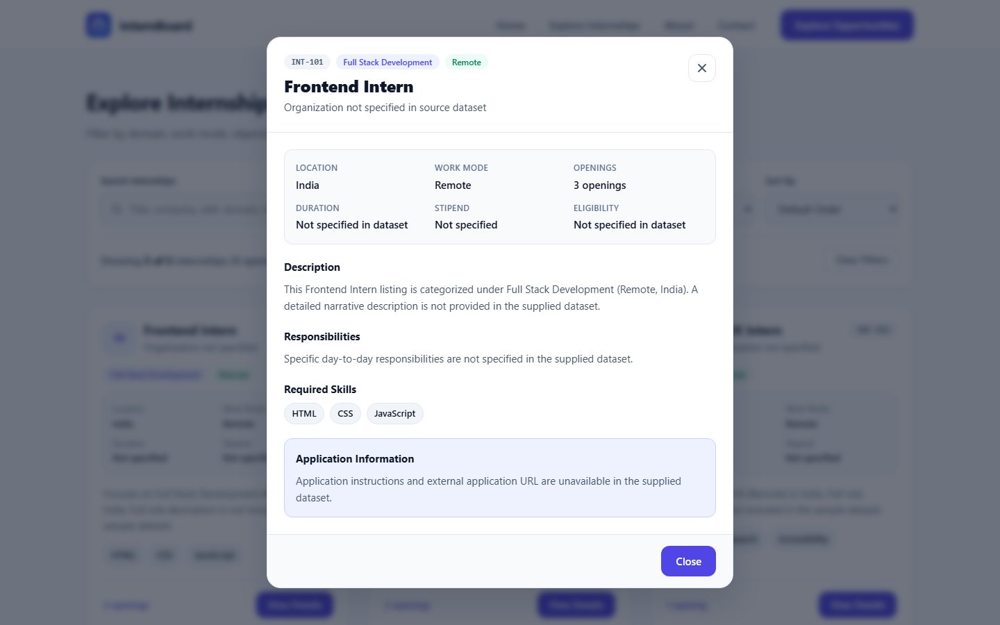
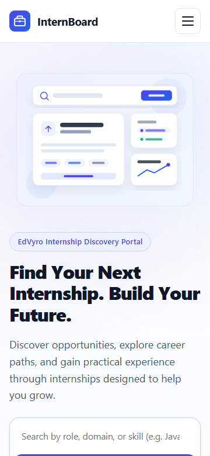

# InternBoard — Responsive Internship Board

> **EdVyro Full Stack Development Internship – Task 2**  
> A responsive, accessible internship discovery platform built entirely with semantic **HTML5**, modern **CSS3**, and modular **Vanilla JavaScript (ES6+)** with zero frontend frameworks.

---

## 1. Project Overview

**InternBoard** is a clean, production-structured web application that lets students explore internship opportunities, search across titles, domains, skills, and locations, combine multiple filters, inspect full role details in a keyboard-accessible modal, and browse comfortably across mobile, tablet, and desktop screens.

---

## 2. Problem Statement

Students searching for early-career internships often encounter cluttered job boards that mix unverified information, lack clear skill tags, or fail on mobile devices and keyboard-only navigation. InternBoard solves this by presenting structured internship records from a validated JSON dataset in a fast, distraction-free, responsive, and accessible interface.

---

## 3. Features

- **Dynamic Dataset Loading & Validation**: Fetches and validates records from `data/internships.json` (sourced from the official EdVyro sample dataset) without fabricating missing fields.
- **Live Statistics Dashboard**: Automatically calculates Total Internships, Total Openings, Available Domains, Remote Opportunities, and Paid Opportunities from the loaded dataset.
- **Case-Insensitive Search**: Searches across internship title, company (if provided), description (if provided), domain, required skills, location, and ID, trimming extra whitespace and syncing the Hero search bar with the Listing search bar.
- **Combined Multi-Filter & Sorting Controls**: Filter simultaneously by **Domain**, **Work Mode** (`Remote`, `Hybrid`, `On-site`), and **Stipend** (`All`, `Paid`, `Unpaid`, `Not Specified`), and sort by Default Order, Title (`A–Z` / `Z–A`), Openings (`High to Low` / `Low to High`), or Domain (`A–Z`).
- **Accessible Details Modal**: Opens a `role="dialog"` (`aria-modal="true"`) modal displaying metadata, description, responsibilities, required skills, eligibility, and application status, with focus trapping, `Escape`-key closing, backdrop closing, and focus restoration to the triggering button.
- **Empty & Error States**: Displays a helpful empty state (`"No internships found."`) with **Clear Filters** / **Reset Search** actions, plus a recoverable error state with console diagnostics and a **Retry** button when data loading fails.
- **Responsive Mobile Navigation**: Sticky header with a keyboard-accessible hamburger menu (`aria-expanded`, `aria-controls`, `Escape`-key dismissal).

---

## 4. Technology Stack

- **HTML5**: Semantic landmarks (`<header>`, `<nav>`, `<main>`, `<section>`, `<article>`, `<footer>`), explicit form labels, and ARIA attributes.
- **CSS3**: Custom properties (`:root` variables), CSS Grid, Flexbox, sticky header, `prefers-reduced-motion` support, and multi-breakpoint responsive styles (`css/style.css` + `css/responsive.css`).
- **Vanilla JavaScript (ES6+)**: Modular ES6 architecture (`js/app.js`, `js/data.js`, `js/validation.js`, `js/filters.js`, `js/ui.js`) using safe DOM APIs (`createElement`, `textContent`) to prevent HTML injection.
- **Data**: JSON (`data/internships.json`) preserving the official EdVyro sample records (`INT-101` through `INT-105`).

*Zero frameworks or UI libraries are used (no React, Vue, Angular, Next.js, Bootstrap, or Tailwind CSS).*

---

## 5. Project Folder Structure

```text
.
├── index.html
├── css/
│   ├── style.css
│   └── responsive.css
├── js/
│   ├── app.js
│   ├── data.js
│   ├── filters.js
│   ├── ui.js
│   └── validation.js
├── data/
│   └── internships.json
├── assets/
│   └── images/
│       ├── hero-illustration.svg
│       └── logo.svg
├── screenshots/
│   ├── desktop-1440.png
│   ├── listings-desktop.png
│   ├── modal-details.png
│   ├── empty-state.png
│   ├── error-state.png
│   ├── tablet-768.png
│   └── mobile-360.png
├── .gitignore
└── README.md
```

*(Note: Entry files are placed at the repository root so GitHub Pages and Netlify can deploy directly from the `main` branch root without extra path configuration.)*

---

## 6. Installation Instructions

1. Clone the repository:
   ```bash
   git clone https://github.com/nijjukrr/EDVYRO--RESPONSIVE-Internship-.git
   cd EDVYRO--RESPONSIVE-Internship-
   ```
2. No `npm install` or build step is required because the project uses pure HTML, CSS, and native ES6 modules.

---

## 7. How to Run Locally

Because the application loads `data/internships.json` via `fetch()` and uses `<script type="module">`, run it through a local static HTTP server rather than opening `index.html` over `file://`:

- **Option A — VS Code Live Server**: Right-click `index.html` and select **Open with Live Server**.
- **Option B — Python**:
  ```bash
  python -m http.server 8080
  ```
  Then open `http://localhost:8080` in your browser.
- **Option C — Node.js**:
  ```bash
  npx serve .
  ```

---

## 8. How Search and Filters Work

1. **Validation (`js/validation.js`)**: `validateDataset()` and `validateInternship()` check required fields (`id`, `title`, `domain`, `mode`, `location`, `skills`), normalize whitespace, sanitize any optional `http:`/`https:` `applicationUrl`, and leave omitted optional fields as `null` instead of fabricating values.
2. **Search (`searchInternships`)**: Trims leading/trailing whitespace, converts the query to lowercase, and checks `id`, `title`, `company`, `description`, `domain`, `location`, `mode`, and every entry in `skills`.
3. **Composable Filters (`applyAllFilters`)**: Chains `searchInternships()` → `filterByDomain()` → `filterByWorkMode()` → `filterByStipend()` → `sortInternships()` on immutable copies of the dataset so every filter updates simultaneously with the search bar and live results counter.

---

## 9. Accessibility Features

- **Skip Link**: `"Skip to main content"` link visible on keyboard focus.
- **Semantic Landmarks & Headings**: Single `<h1>` in the hero followed by ordered `<h2>` and `<h3>` headings.
- **Explicit Form Labels**: Every `<input>` and `<select>` element has a matching `<label for="...">`.
- **Keyboard Navigation & Focus Management**:
  - Visible `:focus-visible` outlines across links, buttons, inputs, and selects.
  - Modal traps `Tab` and `Shift+Tab` inside the dialog, closes on `Escape`, and returns focus to the triggering **View Details** button.
  - Mobile hamburger menu updates `aria-expanded` and closes on `Escape`.
- **Live Announcements**: `#results-count` uses `aria-live="polite"` to announce updated match counts.
- **Reduced Motion**: Honors `@media (prefers-reduced-motion: reduce)`.

---

## 10. Responsive Design Details

Tested across mobile, tablet, and desktop viewports with zero horizontal overflow (`scrollWidth <= innerWidth`):

- **Mobile (`360px`, `375px`, `390px`, `430px`)**: Single-column card layout, collapsible hamburger navigation drawer, stacked hero search bar and card action footer, touch-friendly `>= 44px` controls.
- **Tablet (`768px`, `1024px`)**: Two-column statistics and listing grid, multi-row filter controls.
- **Desktop (`1280px`, `1440px`, `1920px`)**: Three-column internship card grid, four-column statistics bar, and single-row five-control search/filter panel inside a `1240px` max-width container.

---

## 11. Testing & Verification Results

All tests have been executed and verified using Node.js test suites and headless Chrome DevTools Protocol (CDP) automation across both the local server and the live GitHub Pages deployment.

### Functional Verification
- **Dataset Loading**: 5/5 valid records loaded from `data/internships.json` (`INT-101` through `INT-105`) with 0 schema validation errors.
- **Dynamic Statistics**: Calculated dynamically from dataset: 5 active listings, 9 total openings, 4 unique domains, 3 remote opportunities, 0 paid (accurately reflects dataset where stipend values are not specified).
- **Search Verification**: Case-insensitive and trimmed search tested (`"  JAVASCRIPT "` returns `INT-101`, `"sql"` returns `INT-102` & `INT-104`, nonexistent terms display empty state). Hero search input and listing search input are fully synchronized.
- **Domain & Mode Filtering**: Multiple simultaneous filter conditions tested (`Full Stack Development` + `Hybrid` returns `API Engineering Intern` `INT-102`).
- **Sorting**: Verified `Title (A–Z)`, `Title (Z–A)`, `Openings (High to Low)`, and `Openings (Low to High)`.
- **Clear Filters**: Restores full 5-card list, clears search inputs, and resets all dropdowns.
- **Empty State**: Displays `"No internships found."` with active **Clear Filters** and **Reset Search** buttons.
- **Error & Recovery State**: Simulated HTTP 500 error triggers error card with diagnostic message; clicking **Retry** successfully re-fetches and renders all listings.
- **Modal & Accessibility**:
  - Details modal displays all metadata, responsibilities, required skills, and clear application status without fabricating missing URLs.
  - Initial focus moves to the top close button (`#modal-close-top`).
  - Focus is trapped within modal interactive elements.
  - Pressing `Escape` closes the modal and restores keyboard focus to the triggering **View Details** button.
- **Form Accessibility**: 100% of `<input>` and `<select>` controls have explicit, programmatic `<label for="...">` associations.
- **Zero Console Errors**: 0 uncaught exceptions and 0 network/console errors during standard operation.

### Responsive Viewport Verification (Zero Horizontal Overflow)
- **360px** (Small mobile): Passed (`scrollWidth <= innerWidth`), collapsible mobile hamburger menu verified.
- **375px** (iPhone SE): Passed (`scrollWidth <= innerWidth`).
- **390px** (iPhone 12/13/14): Passed (`scrollWidth <= innerWidth`).
- **430px** (iPhone 14 Pro Max): Passed (`scrollWidth <= innerWidth`).
- **768px** (Tablet portrait): Passed (`scrollWidth <= innerWidth`), 2-column stats and card layouts.
- **1024px** (Tablet landscape / small laptop): Passed (`scrollWidth <= innerWidth`).
- **1280px** (Desktop standard): Passed (`scrollWidth <= innerWidth`), 3-column card grid.
- **1440px** (Desktop large): Passed (`scrollWidth <= innerWidth`).
- **1920px** (Full HD desktop): Passed (`scrollWidth <= innerWidth`).

---

## 12. Screenshots

| Desktop Hero & Stats (`1440px`) | Desktop Listings (`1440px`) |
| --- | --- |
|  |  |

| Details Modal | Empty State | Error State |
| --- | --- | --- |
|  |  |  |

| Tablet (`768px`) | Mobile (`360px`) |
| --- | --- |
|  |  |

---

## 13. Deployment & Live URLs

- **Live Deployed Website**: [https://nijjukrr.github.io/EDVYRO--RESPONSIVE-Internship-/](https://nijjukrr.github.io/EDVYRO--RESPONSIVE-Internship-/) *(Verified HTTP 200 on GitHub Pages)*
- **GitHub Repository**: [https://github.com/nijjukrr/EDVYRO--RESPONSIVE-Internship-](https://github.com/nijjukrr/EDVYRO--RESPONSIVE-Internship-)
- **Deployment Source**: Branch `main`, Directory `/ (root)`

---

## 14. Deployment Instructions (GitHub Pages & Netlify)

### Pushing Updates to GitHub

```bash
git add .
git commit -m "Update documentation or features"
git push origin main
```

### GitHub Pages Configuration

1. Open your repository on GitHub: `https://github.com/nijjukrr/EDVYRO--RESPONSIVE-Internship-`
2. Go to **Settings → Pages**.
3. Under **Build and deployment**, select:
   - **Source**: `Deploy from a branch`
   - **Branch**: `main`
   - **Folder**: `/ (root)`
4. Click **Save**. GitHub Pages automatically builds and deploys to `https://nijjukrr.github.io/EDVYRO--RESPONSIVE-Internship-/`.

### Alternative: Deploy on Netlify

1. Log in to [Netlify](https://www.netlify.com/) and choose **Add new site → Import an existing project**.
2. Connect your GitHub repository (`EDVYRO--RESPONSIVE-Internship-`).
3. Set build command to empty and publish directory to `.` (root).
4. Click **Deploy site**.

---

## 14. Future Improvements

- Add pagination or lazy loading if the dataset grows to hundreds of listings.
- Support bookmarking/saving favorite internships in `localStorage`.
- Add URL query parameter synchronization so filtered views can be shared directly via link.
- Add optional dark mode toggle using CSS custom properties.
